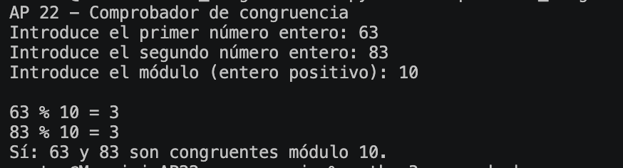
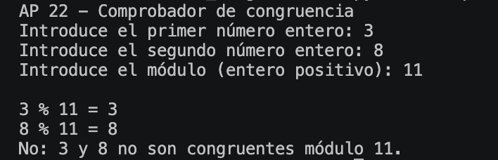

# 🔢 AP 22 · Comprobador de congruencia

**Ironhack | MF0489_3 - Sistemas seguros de acceso y transmisión de datos**

## 📝 El ejercicio

En esta práctica he creado un programa en Python que pide dos números enteros y un módulo positivo para comprobar si son congruentes.

Dos números son congruentes respecto a un módulo cuando dejan el mismo resto al dividirlos entre él. Para comprobarlo he utilizado el operador `%`, que calcula el resto de una división.

El programa muestra ambos restos y el resultado de la comparación. También comprueba que se introduzcan números enteros y que el módulo sea mayor que cero.

## ▶️ Ejecución

Desde la terminal, en la carpeta del proyecto:

```bash
python3 comprobador_congruencia.py
```

## 📸 Ejemplos

### Números congruentes

Con 63 y 83, utilizando módulo 10, ambos restos son 3. Por tanto, son congruentes.



### Números no congruentes

Con 3 y 8, utilizando módulo 11, los restos son 3 y 8. Como son diferentes, no son congruentes.




## 🧠 Qué he aprendido

He aprendido a comprobar si dos números son congruentes comparando sus restos con `%`. También he practicado las funciones y cómo comprobar que los datos introducidos sean válidos.